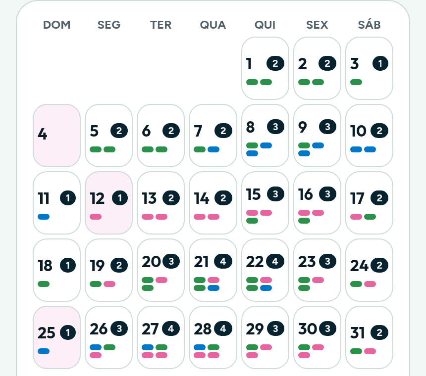
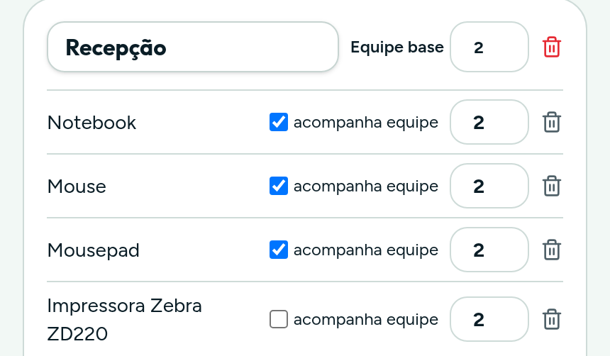
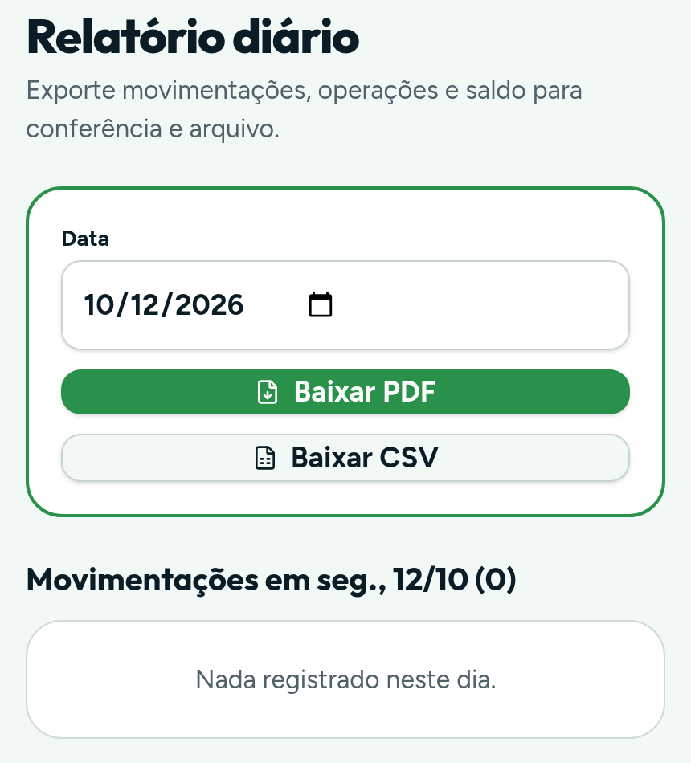

# TrackPoint

**Controle de saída e retorno de equipamentos de TI, com QR Code e relatório em PDF.**

`ESTUDO DE CASO` · `PILOTO`

> Este repositório é um estudo de caso. O código-fonte é privado e as telas usam dados fictícios de demonstração.

## O problema

Em dias de pico, equipamentos de TI saem e voltam o dia inteiro. A conferência era feita à mão e o registro ficava para depois, quando sobrava tempo. Nessa janela, ninguém sabia dizer com segurança o que estava no estoque, o que estava em campo e o que ainda não tinha voltado.

## A solução

Uma aplicação web que acompanha cada equipamento do cadastro ao retorno:

1. **Entrada.** Cada equipamento é cadastrado uma vez e recebe um QR Code.
2. **Agenda.** As saídas programadas ficam em um calendário, com a quantidade de operações por dia.
3. **Kit padrão.** Cada tipo de operação tem um kit-modelo; o sistema calcula as quantidades conforme o tamanho da equipe.
4. **Separação e retorno.** A conferência é feita lendo o QR Code com a câmera, na saída e na volta.
5. **Relatório.** O dia é fechado em PDF ou CSV, para conferência e arquivo.

## Telas

| Agenda de saídas | Kit padrão | Relatório do dia |
| :---: | :---: | :---: |
|  |  |  |

## Decisões técnicas

- **Site estático, sem servidor de aplicação.** O build gera arquivos que rodam em qualquer servidor web, inclusive em subdiretório. Era o caminho mais rápido para colocar um piloto em uso.
- **Dados no navegador, com cópia de segurança.** O estado fica salvo localmente e pode ser exportado e restaurado em um arquivo. Para um piloto, isso dispensa banco de dados e autenticação.
- **Três formas de controle.** Itens com patrimônio são cadastrados um a um; insumos são contados por quantidade; serviços entram só como lista de verificação.
- **Validação e testes.** Formulários validados com Zod e regras de estoque cobertas por testes automatizados com Vitest.
- **Pensado para o celular.** A conferência acontece em pé, no estoque; a interface foi desenhada primeiro para a tela pequena.

## Stack

React · TypeScript · Vite · Tailwind CSS · TanStack Router · Zustand · Zod · Vitest · html5-qrcode · jsPDF

## Estágio

Piloto. Ainda não tem integração com sistemas externos nem controle de acesso por usuário.

## Autor

Concebido e desenvolvido por [Leonardo Magalhães](https://github.com/leomagalhaesti).

Quer algo parecido para a sua operação? Fale comigo pelo [LinkedIn](https://www.linkedin.com/in/leomagalhaesti/) ou por [e-mail](mailto:leomagalhaes.ti@gmail.com).
